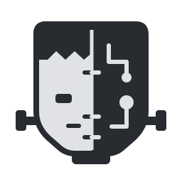
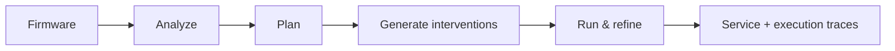

<p align="center">
  <picture>
    <source media="(prefers-color-scheme: dark)" srcset="assets/brand/logo-dark.svg">
    
  </picture>
</p>

<p align="center"><strong>Agent-driven firmware rehosting for dynamic analysis.</strong></p>

<p align="center">
  
  
  <a href="LICENSE"></a>
</p>

Firmenstein brings Linux firmware services into a local environment for dynamic
analysis and bug reproduction. Its agents analyze service dependencies,
generate API-level interventions, and refine them using execution traces and
native interactions.

This repository accompanies our **USENIX Security '26** paper:
*Firmenstein: Scaling Dynamic Analysis for Linux-Based Firmware Services*.

- **Analyze dependencies.** Identify the APIs and environment behavior needed
  to run a target firmware service.
- **Build interventions.** Generate and refine code that supplies the missing
  environment behavior.
- **Run and inspect.** Interact with the original service and retain its traces,
  code changes, and startup instructions for further analysis.

## How it works



[GuestWeave](https://github.com/Firmenstein/GuestWeave) provides the intervention
API and execution runtime. Firmenstein coordinates analysis, intervention
generation, and the agent-driven rehosting workflow.

## Getting started

Prepare a **Linux x86_64** host with **Python 3.12+**, **Git**, **uv**, **Docker with
Compose**, and **IDA Pro 9.1+ with idalib, the required decompiler, and your own
license**. The agents use an Anthropic Messages-compatible model API through
Claude Agent SDK. See the [setup requirements](CONFIGURATION.md#setup-requirements).

```sh
git clone https://github.com/Firmenstein/Firmenstein.git
cd Firmenstein

uv venv src/.venv --python 3.12
source src/.venv/bin/activate
uv pip install -e './src[ida]'
cp .env.example .env

python src/scripts/prepare_guestweave.py
```

Edit `.env` with your model API settings, IDA installation and user-profile
paths, and the GuestWeave workspace path printed by the preparation command.
See the [configuration reference](CONFIGURATION.md) for environment variables,
defaults, command-line options, and Runner settings.

Build the firmware extractors:

```sh
docker compose build extractor-1 extractor-2
```

Then follow the [Runner setup](docker/runner-agent/README.md) to prepare the
isolated task engine and build your local runtime image. Save the resulting
engine, image, and runtime-input settings in `.env`.

## Rehost a service

Extract a firmware image and select the service to run:

```sh
mkdir -p workspace/demo/runs

python main.py extract \
  --input /path/to/firmware.bin \
  --output workspace/demo/rootfs \
  --metadata-output workspace/demo/metadata.json

python main.py analyze \
  --firmware-metadata workspace/demo/metadata.json \
  --target-binary httpd \
  --workdir workspace/demo/runs \
  --run-after-generation
```

Replace `httpd` with your target service. The agents analyze its dependencies,
generate interventions, then run and refine the service in the local environment.
Set `FMST_REHOSTING_GOAL` in `.env` to describe the behavior you want to exercise.

For all available options, run `python main.py --help`.

## Use the rehosted service

Firmenstein saves analysis reports, intervention code, and execution evidence
in the work directory. A completed delivery includes a README and an `fmst`
launcher for managing the service.

From the generated delivery directory:

```sh
./fmst up
./fmst open
```

Use `./fmst status` to inspect the instance, `./fmst logs` to view its logs,
and `./fmst down` to stop it.

`./fmst open` uses Chrome/Chromium on your desktop. For headless or
container-only access, follow the generated delivery README.

## Citation

If you use Firmenstein in your research, please cite:

> *Firmenstein: Scaling Dynamic Analysis for Linux-Based Firmware Services.*
> USENIX Security Symposium, 2026.

## License

Firmenstein is licensed under [Apache-2.0](LICENSE).
